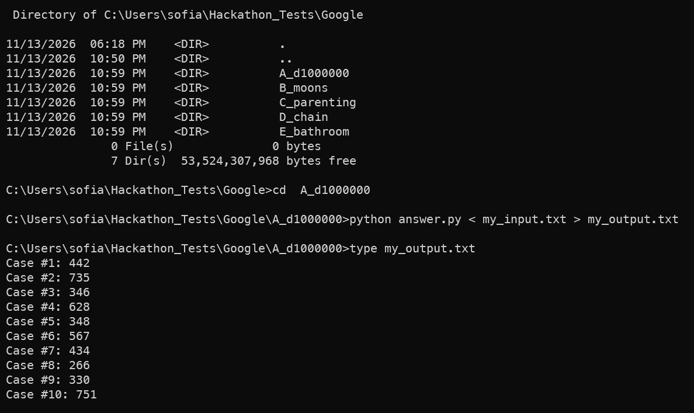
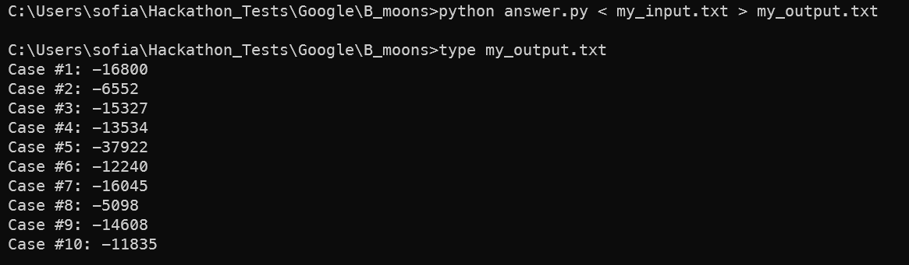
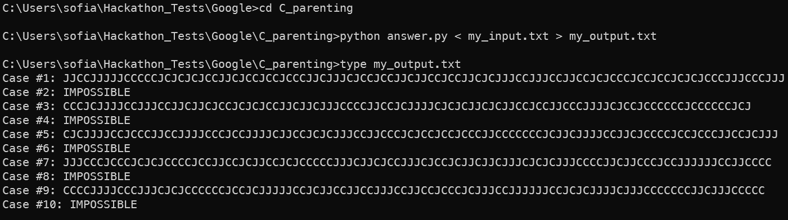
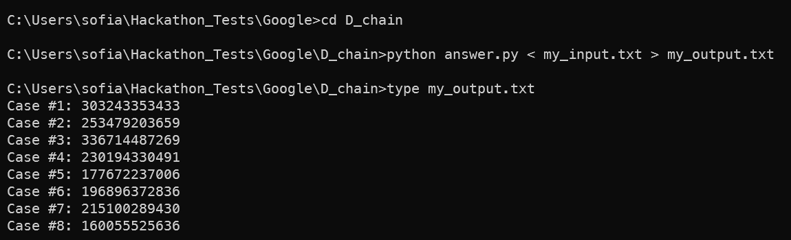
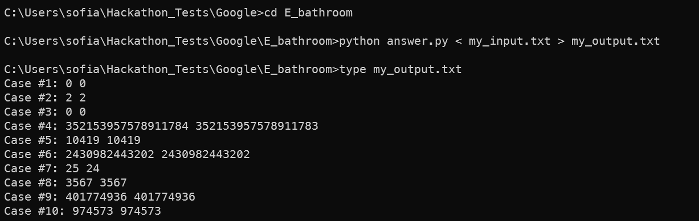

# Hackathon Tests

## Autora: Ángela Gómez

**Nota**: Debido a la complejidad de algunos ejercicios, el código fue retroalimentado por Claude (hace mucho no programo en Python para este tipo de ejercicios a pesar de entender la teoría)

## Cómo ejecutar cualquier ejercicio

```bash
cd google/A_d1000000
python answer.py < my_input.txt > my_output.txt   # el input dado por los html
```
```bash
cd anthropic/A_streaming
python answer.py < my_input.txt > my_output.txt   # el input dado por los html
```
---

# Parte 1: Prueba Google (Code Jam)

Resumen de los cinco ejercicios:

| Ejercicio | Tema | Técnica principal | Estructura de datos | Complejidad |
|---|---|---|---|---|
| A. d1000000 | Ordenamiento y voraz | Ordenar + greedy | Lista ordenada | O(N log N) |
| B. Moons and Umbrellas | Programación dinámica | DP con 2 estados | 2 variables (`dc`, `dj`) | O(N) |
| C. Parenting Partnering Returns | Intervalos y voraz | Ordenar por inicio + greedy | Lista de tuplas, 2 "relojes" | O(N log N) |
| D. Chain Reactions | Árboles / DFS | Recorrido bottom-up en bosque | Lista de hijos, arreglo `mejor` | O(N) |
| E. Bathroom Stalls | Eficiencia con números enormes | Conteo de segmentos por tamaño | Diccionario `tamaño -> cantidad` | O(log N) |

---

## A. d1000000 (Ordenamiento y voraz)

**Problema.** Dados N dados con `S_i` caras, formar la escalera 1, 2, 3, ..., L usando cada dado a lo sumo una vez. Se pide el mayor L.

**Algoritmo: ordenar + greedy.**
1. Ordenar los dados de menor a mayor número de caras.
2. Mantener `largo` (longitud actual de la escalera).
3. Para cada dado: si `S_i > largo`, el dado puede mostrar `largo + 1`, entonces `largo += 1`. Si no, se descarta.

**Por qué funciona (argumento voraz).** Procesar los dados pequeños primero evita "desperdiciar" dados grandes en valores bajos. Si un dado no alcanza el siguiente valor necesario (`S_i <= largo`), tampoco serviría para valores mayores, así que descartarlo es seguro.

---

## B. Moons and Umbrellas (Programación dinámica)

**Problema.** Dada una cadena de `C`, `J` y `?`, reemplazar cada `?` para minimizar el costo total: cada `CJ` cuesta X y cada `JC` cuesta Y (pueden ser negativos).

**Algoritmo: programación dinámica con dos estados por posición.**

- `dc[i]` = costo mínimo de la subcadena hasta `i` si la letra en `i` es C.
- `dj[i]` = costo mínimo de la subcadena hasta `i` si la letra en `i` es J.

**Recurrencia:**

```
dc[i] = min(dc[i-1], dj[i-1] + Y)     si s[i] != 'J'   (si no, INF)
dj[i] = min(dj[i-1], dc[i-1] + X)     si s[i] != 'C'   (si no, INF)
```

**Caso base:** `dc[0] = 0` si `s[0] != 'J'`; `dj[0] = 0` si `s[0] != 'C'` (el estado inválido vale INF).

**Respuesta:** `min(dc[n-1], dj[n-1])`.

---

## C. Parenting Partnering Returns (Intervalos y voraz)

**Problema.** Asignar N actividades `[s, e)` a Cameron (C) y Jamie (J) sin que ninguno tenga dos actividades simultáneas, o decir `IMPOSSIBLE`.

**Algoritmo: ordenar por inicio + greedy con dos "relojes".**
1. Guardar cada actividad como `(inicio, fin, índice_original)` y ordenar por inicio.
2. Mantener `fin_C` y `fin_J` (momento en que cada persona queda libre, inicialmente 0).
3. Para cada actividad: si `fin_C <= inicio` se asigna a C; si no, si `fin_J <= inicio` se asigna a J; si ninguno está libre, el caso es `IMPOSSIBLE`.
4. Reconstruir la cadena en el **orden original** usando el índice guardado.

**Por qué funciona.** Si en algún instante hay tres actividades solapadas, ninguna asignación sirve. Si nunca hay tres solapadas, procesar por inicio con cualquier persona libre es suficiente (grafo de intervalos 2-coloreable). La condición es `<=` porque una actividad puede comenzar justo cuando otra termina.

---

## D. Chain Reactions (Árboles y DFS)

**Problema.** N módulos con diversión `F_i`; cada módulo apunta a un `P_i < i` o al abismo (0). Los módulos a los que nadie apunta son iniciadores; activar uno recorre su cadena y aporta el mayor F de lo que activó. Maximizar la diversión total escogiendo el orden de los iniciadores.

**Modelo:** los punteros forman un **bosque** (varios árboles cuya raíz virtual es el abismo 0). Los iniciadores son las hojas.

**Algoritmo: recorrido bottom-up (hijos antes que padres).** Como `P_i < i`, recorrer `i = N ... 1` ya garantiza que todos los hijos de `i` se procesan antes que `i`; no hace falta recursión.

**Recurrencia.** Sea `mejor[i]` el valor de la cadena que "sube" por el nodo `i`:

```
si i es hoja:          mejor[i] = F[i]
si no:                 m = min(mejor[k] para k hijo de i)
                       total += sum(mejor[k]) - m
                       mejor[i] = max(F[i], m)
```

**Idea.** Entre las cadenas de los hijos, solo una puede continuar pasando por `i`. Conviene que sea la de **menor** valor, porque las demás se cierran antes de llegar a `i` y aportan su valor completo. Para los hijos de la raíz virtual 0, todas las cadenas se cierran y se suman completas.

---

## E. Bathroom Stalls (Eficiencia con números enormes)

**Problema.** N cubículos (hasta 10^18) y K personas que eligen según una regla. Hallar `max(L, R)` y `min(L, R)` de la última persona.

**Observación clave.** Cada vez que alguien ocupa un segmento libre de tamaño `x`, lo parte en dos segmentos de tamaño `x // 2` y `(x - 1) // 2`. En cada "nivel" solo existen **como máximo dos tamaños distintos** (consecutivos), así que no hace falta simular persona por persona.


---

## Algunas evidencias del ejercicio















---

# Parte 2: Prueba Anthropic (API de Claude)


| Ejercicio | Tema | Técnica principal | Estructura de datos | Complejidad |
|---|---|---|---|---|
| A. Respuesta en streaming | Streaming (eventos SSE) | Máquina de estados sobre eventos | Diccionario `index -> texto` | O(n), n = líneas de la entrada |
| B. Uso de herramientas | Tool use | Despacho por nombre de herramienta | Diccionarios (ciudades, herramientas) y contadores | O(n), n = llamadas a herramientas |
| C. Costos con caché | Prompt caching y precios | Aritmética entera con precios x100 | Enteros y contadores | O(n), n = solicitudes |
| D. Límites de velocidad | Rate limits | Cubeta de tokens (token bucket) | Dos cubetas (tokens y última marca de tiempo) | O(n), n = solicitudes |
| E. Evaluación de respuestas | Evals calificadas con código | Normalización + coincidencia de palabras completas | Diccionario categoría -> [aprobadas, total] | O(L), L = caracteres totales |

---

## A. Respuesta en streaming

**Qué se pide.** Reconstruir cada mensaje a partir de los eventos `event:` / `data:` e imprimir `texto`, `stop_reason`, `input_tokens` y `output_tokens`.

**Técnica.** Máquina de estados: se procesa cada evento en orden y se actúa según su tipo.

| Evento | Acción |
|---|---|
| `message_start` | Reinicia el mensaje y guarda `usage.input_tokens` |
| `content_block_delta` (`text_delta`) | Agrega el texto al bloque de su `index` |
| `message_delta` | Guarda `stop_reason` y `usage.output_tokens` |
| `ping` | Se ignora |
| `message_stop` | Imprime las 4 líneas del mensaje |

**Detalle clave.** El texto final es la unión de los bloques **ordenados por `index`**. La línea `data:` se lee como JSON.

**Estructura de datos.** Diccionario `index -> texto` por mensaje, más variables para `stop_reason` y los tokens.

---

## B. Uso de herramientas

**Qué se pide.** Cada línea es una respuesta del modelo. Con `tool_use` se ejecutan las herramientas pedidas y se imprime `tool_result <id> <resultado>`; con `end_turn` se imprime `final: <texto>`. Al final, `resumen: N llamadas, E errores`.

**Técnica.** Despacho por nombre: según `name` se llama a la función que corresponde.

| Herramienta | Regla |
|---|---|
| `calculadora` | `sumar`, `restar`, `multiplicar`, `dividir` (entera) sobre `a` y `b` |
| `clima` | Bogotá 14, Medellín 24, Cali 26, con formato `24 °C` |

**Errores (cuentan para el resumen).**
- Dividir por cero: `error: división por cero`.
- Operación inválida: `error: operación desconocida: X`.
- Ciudad inválida: `error: ciudad desconocida: X`.
- Herramienta inválida: `error: herramienta desconocida: X`.

**Detalle clave.** Un mismo mensaje puede traer varios bloques `tool_use`: se ejecutan en orden y se ignoran los bloques de tipo `text`. Una llamada es un error si su resultado empieza con `error:`.

**Estructura de datos.** Diccionario de ciudades a temperatura, diccionario de herramientas disponibles y dos contadores (llamadas y errores).

---

## C. Costos con caché de prompts

**Qué se pide.** Costo de cada llamada con $3 por millón de tokens de entrada y $15 por millón de salida. Escribir en caché cuesta 1,25 veces la entrada y leer de caché, 0,1 veces. Se imprime cada solicitud, el total, el costo sin caché, el ahorro y los aciertos de caché.

**Técnica.** Todo en enteros, en millonésimas de dólar, para evitar errores de redondeo con decimales. Para que los precios por token sean enteros se multiplican por 100 y se divide entre 100 al final:

| Concepto | Precio por token (x100) |
|---|---|
| Entrada normal | 300 |
| Escritura en caché | 375 |
| Lectura de caché | 30 |
| Salida | 1500 |

**Fórmulas.**

```
costo     = (input*300 + creacion*375 + lectura*30 + salida*1500) // 100
sin_cache = (input + creacion + lectura)*3 + salida*15
ahorro    = sin_cache - total
aciertos  = llamadas con cache_read_input_tokens > 0
```

**Formato.** Para imprimir sin usar decimales flotantes: `f"${m // 1_000_000}.{m % 1_000_000:06d}"`.

**Estructura de datos.** Solo enteros acumuladores (`total`, `sin_cache`, `aciertos`).

---

## D. Límites de velocidad

**Qué se pide.** Para cada `REQUEST t nuevos de_cache`, responder `ok` o `429 retry-after=N`.

**Técnica.** Dos cubetas de tokens que se recargan de forma continua:

| Cubeta | Capacidad | Recarga |
|---|---|---|
| Solicitudes | 3 | 1 por segundo |
| Tokens de entrada | 100 | 20 por segundo |

Ambas empiezan llenas.

**Reglas.**
1. Al llegar una solicitud en el segundo `t`, se recargan las dos cubetas: `tokens = min(capacidad, tokens + recarga * (t - ultima_marca))`.
2. Si hay al menos 1 solicitud disponible y `nuevos` tokens disponibles, se gastan y se responde `ok`.
3. Si no alcanza, **no se gasta nada** y se responde `429 retry-after=N`, con `N = max(ceil((1 - solicitudes) / 1), ceil((nuevos - tokens) / 20))`.
4. Los tokens `de_cache` se ignoran: no gastan.

**Detalle clave.** El `ceil` se hace con enteros: `-(-a // b)`. La recarga se aplica en cada línea, aunque la respuesta sea 429.

**Estructura de datos.** Dos cubetas con su nivel actual y una marca de tiempo compartida de la última recarga.

---

## E. Evaluación de respuestas

**Qué se pide.** Una respuesta pasa si lo esperado aparece como palabras completas dentro de la respuesta, tras normalizar ambas. Se imprime `categoria: aprobadas/total` en orden alfabético y `total: a/n (p%)`.

**Técnica.** Normalización + búsqueda de palabras completas.

1. **Normalizar:** pasar a minúsculas, quitar tildes (`unicodedata.normalize("NFD", ...)` y eliminar las marcas combinantes), reemplazar todo lo que no sea letra o número por un espacio y colapsar los espacios.
2. **Comparar con espacios en los bordes:** `" " + esperado + " "` debe estar dentro de `" " + respuesta + " "`. Así `42` no pasa con `420`.

**Resultado.** El porcentaje se imprime con un decimal: `f"{a * 100 / n:.1f}"`.

**Estructura de datos.** Diccionario `categoria -> [aprobadas, total]`; las categorías se imprimen con `sorted()`.

---

## Algunas evidencias del ejercicio


